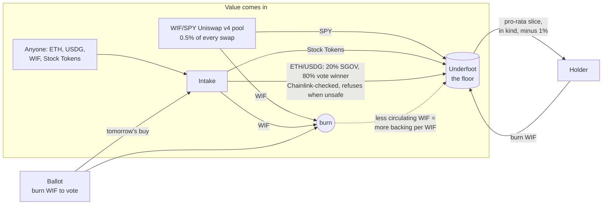

# Underfoot

**A floor of Stock Tokens under every $WIF, on Robinhood Chain.**

Underfoot is a contract with no owner that holds a basket of Robinhood Chain Stock Tokens — SGOV (T-bills) plus SPY, QQQ, NVDA, TSLA, AAPL, MSFT, GOOGL, AMZN and META. Anyone holding $WIF can burn it and take their pro-rata slice of every asset in the basket, in kind. A 1% exit fee stays behind, so **the backing per circulating WIF can only go up** — and because the denominator is circulating supply, **every WIF burned anywhere on the chain raises it too**: Pons buybacks, game rounds, community votes, ours.

Most $WIF utilities burn the token and call it a flywheel. A burn makes WIF scarcer; it doesn't give anyone a reason to come back, and it works the same with any token. Underfoot makes WIF the only key to a growing basket of real assets, and turns every burn on the chain into backing for the holders who stay.

- **Live app:** https://underfoot-brown.vercel.app · **Demo video (2 min):** https://youtu.be/XIffO1OwG0c · **MCP:** https://underfoot-brown.vercel.app/api/mcp
- **Contracts (verified, no owner):** see [Deployment](#deployment)
- **Review in five minutes:** [REVIEW.md](REVIEW.md) · **What we claim and how to check it:** [CLAIMS.md](CLAIMS.md) · **Self-review:** [AUDIT.md](AUDIT.md)

---

## How it works



| Contract | What it does | What it refuses |
|---|---|---|
| `Underfoot` | Holds the basket. `redeem(wif, to, skipMask)` burns your WIF and pays `balance × wif / circulating × 99%` of every asset. No oracle, no owner. | Redeeming the whole supply; nothing else — a paused or blocklisted Stock Token can be skipped, and its share stays in for everyone else. |
| `Intake` | Takes ETH, USDG, WIF or Stock Tokens from anyone. Burns WIF on arrival, forwards Stock Tokens, and `convert` buys Stock Tokens with ETH/USDG on fixed Uniswap v3 routes: 20% to SGOV, 80% to the Ballot's pick. | A leg whose Stock Token or oracle is paused, whose Chainlink feed is stale (markets closed), or whose route has any pool more than 0.75% off Chainlink — that leg's share goes to the other one; if neither can trade, nothing moves. Fills worse than Chainlink −1.5%. More than $1,000 per hour. |
| `Ballot` | 24h epochs from 00:00 UTC. Burn WIF to vote which Stock Token the floor buys tomorrow (no same-day steering). No votes: SPY. | The cash leg as an option; votes under 1 WIF. |
| `UnderfootHook` | Uniswap v4 hook for one pool, WIF/SPY (0.3% LP fee). Takes 0.5% of the unspecified side: SPY goes straight into the floor, WIF is burned. | Any other pool key (`beforeInitialize` pins it). |
| `UnderfootPaymaster` | ERC-4337 v0.8 paymaster: gas for floor actions is free for EIP-7702 accounts. Needs a sponsor signature **and** on-chain rules. | Anything but `WIF.approve(floor\|ballot)`, `redeem`, `vote`; calls carrying ETH; burns under 100 WIF; costs over the cap; accounts not delegated to the canonical Simple7702Account. No owner, no withdraw. |
| `UnderfootLens` | One view call for apps: every asset's balance, multiplier, Chainlink price and value, backing per WIF, WIF spot price, today's vote. | — |

### The invariant

For every asset *i* in the basket, `balance_i / circulatingWIF` never decreases. A redemption of *w* out of *S* leaves `(b − b·w/S·0.99) / (S − w) ≥ b/S`, payouts round down, inflows only add, and burns elsewhere only shrink *S*. This is fuzzed as a Foundry invariant across redemptions, votes, burns, transfers to the dead address, inflows and time jumps (`contracts/test/invariant`). The only things that can lower it are outside the protocol: the Stock Token issuer pausing, blocklisting, or seizing (`adminBurn`) tokens.

### Why WIF holders come back

- **Redeem:** WIF is the only way into the basket. When WIF trades below its backing, burning it is free money — arbitrage pushes the price back to the floor.
- **Vote:** every day there's a new buy to decide, and the vote itself is a burn that lifts everyone's backing.
- **Watch it rise:** the app shows the floor, coverage (backing ÷ price) and a ledger of every WIF burned on Robinhood Chain and where it came from.
- **Route fees in:** any project — a game pot, a launchpad's creator fees — can send ETH, USDG or WIF to the Intake in one call, and its users' activity becomes backing.

## Integrate

**Solidity** — send value to the floor from your own contract:

```solidity
interface IUnderfootIntake {
    function fund() external payable;
    function fundToken(address token, uint256 amount) external; // WIF, USDG, WETH or a basket Stock Token
}

// e.g. 2% of every pot
IUnderfootIntake(INTAKE).fund{value: pot * 2 / 100}();
```

**TypeScript** — `packages/sdk` (`@underfoot/sdk`):

```ts
import { createPublicClient, http, parseEther } from "viem";
import { MAINNET, robinhood, getSnapshot, redeemCalls, voteCalls } from "@underfoot/sdk";

const client = createPublicClient({ chain: robinhood, transport: http() });
const floor = await getSnapshot(client, MAINNET!);          // basket, backing per WIF, today's vote
const calls = redeemCalls(MAINNET!, { amount: parseEther("250000"), to: me }); // approve + redeem
```

**MCP** — agents can read the floor and build unsigned calls (never keys):
`pnpm --filter @underfoot/mcp build && node packages/mcp/dist/stdio.js` (stdio) or the app's `/api/mcp` endpoint (streamable HTTP). Tools: `floor_snapshot`, `quote_redeem`, `build_redeem`, `build_vote`, `build_fund`.

## Deployment

Robinhood Chain mainnet (4663), block 102,641,510. Every contract is source-verified on [Sourcify](https://sourcify.dev/#/lookup/0x127946edE935cd492a35df92cB7e75668c42E326) (full match), has no owner, and is checked by `pnpm verify:onchain`.

| Contract | Address |
|---|---|
| Underfoot (the floor) | [`0x127946edE935cd492a35df92cB7e75668c42E326`](https://robinhoodchain.blockscout.com/address/0x127946edE935cd492a35df92cB7e75668c42E326) |
| Ballot | [`0x2fE9cf250d0a5b368f7BF6eeeA1E0923553BAEad`](https://robinhoodchain.blockscout.com/address/0x2fE9cf250d0a5b368f7BF6eeeA1E0923553BAEad) |
| Intake | [`0x165EAC746bed0bB0CCFBAED05452E1a0274b4C5D`](https://robinhoodchain.blockscout.com/address/0x165EAC746bed0bB0CCFBAED05452E1a0274b4C5D) |
| UnderfootHook (WIF/SPY, v4) | [`0x54Ead89e8aC38a818D9ffF9C6217D45A01f66044`](https://robinhoodchain.blockscout.com/address/0x54Ead89e8aC38a818D9ffF9C6217D45A01f66044) |
| UnderfootPaymaster (ERC-4337 v0.8) | [`0xDfF54b91ADF8f69D8CE13E1b2bCa8b31b36fFbc8`](https://robinhoodchain.blockscout.com/address/0xDfF54b91ADF8f69D8CE13E1b2bCa8b31b36fFbc8) |
| UnderfootLens | [`0x1032326f0A7397DBeC75A2e5Ad2B2AC1D68D0F87`](https://robinhoodchain.blockscout.com/address/0x1032326f0A7397DBeC75A2e5Ad2B2AC1D68D0F87) |

Launch transactions, all on mainnet:

- Open the WIF/SPY pool behind the hook through the official PositionManager — [tx](https://robinhoodchain.blockscout.com/tx/0xf5f3697aeaf893aa7eb0fce25758a78515e88511a8d848a7f941640a7fe33da4)
- First buy: the SGOV leg was **skipped** because its feed was stale, so the whole amount went into SPY — [tx](https://robinhoodchain.blockscout.com/tx/0xc7c4e2e7f327bb23be8308a43c1ec7c385c59854f903e7e7c44755cc7bb34a1e)
- Vote for NVDA, 5 WIF burned — [tx](https://robinhoodchain.blockscout.com/tx/0x4ecffbe543368dd1fd226b2e4e4982ae1aa1379a8fd923ea8fddf51467bb59d5)
- **Gasless vote** from an account holding 0 ETH: EIP-7702 delegation + ERC-4337 v0.8 user operation, gas paid by the paymaster, 100 WIF burned — [tx](https://robinhoodchain.blockscout.com/tx/0x9aaba2e91e357f2b29e6042c7c1e73e91fb8d484ef4f229e219279c26c6b2cfd)
- Sell WIF through the hook pool: 0.5% of the SPY out went into the floor — [tx](https://robinhoodchain.blockscout.com/tx/0xd168979e4622db8f6499d2557d81f08767a2f37980108ae9797c6e76fe4fb444)
- Buy WIF through the hook pool: 0.5% of the WIF out was burned — [tx](https://robinhoodchain.blockscout.com/tx/0x9010b64bca96f1df573c4ae1a758280fba5490a46b3a3ec05bd2f1503e3713be)
- WIF sent to the Intake, burned on arrival — [tx](https://robinhoodchain.blockscout.com/tx/0xfa74371e97a4530b3f42342e145a148394a6861007b1b7eb7e06bf260cebd286)
- Redemption: 10 WIF burned, SPY paid out in kind — [tx](https://robinhoodchain.blockscout.com/tx/0x2406285862347a30cdccde1c0aa1f5d0f0500550d3750f1c6513cca8dccd594b)

Reproduce any of them with `contracts/script/Demo.s.sol` (`ACTION=vote|redeem|sell-wif|buy-back|fund-wif|buy-wif`) or `scripts/sponsored-vote.mjs` for the gasless path.

## Run it

```bash
pnpm install
cd contracts && forge test                       # unit, fuzz, invariant (no network)
FOUNDRY_PROFILE=fork forge test                  # against live Robinhood Chain state
cd .. && pnpm verify:onchain                     # check the live deployment against this README
pnpm --filter @underfoot/web dev                 # app at localhost:3000
```

Deploy: `SPONSOR_ADDRESS=0x… forge script script/Deploy.s.sol --rpc-url robinhood --broadcast --verify`, then `script/Seed.s.sol` opens the WIF/SPY pool and seeds the floor, and `node scripts/sync-deployment.mjs` writes the addresses into the SDK.

| Env (apps/web) | Purpose |
|---|---|
| `NEXT_PUBLIC_PRIVY_APP_ID` | Email sign-in with an embedded wallet (enables gasless actions) |
| `NEXT_PUBLIC_RPC_URL` / `RPC_URL` / `LOGS_RPC_URL` | Browser RPC, server RPC (QuickNode in production) and an RPC without log-range caps for the burn-ledger scans |
| `BUNDLER_URL` | ERC-4337 bundler (Pimlico); proxied server-side, only for operations our paymaster sponsors |
| `SPONSOR_PRIVATE_KEY` | Signs sponsorships after simulation and rate limits |
| `KEEPER_PRIVATE_KEY`, `CRON_SECRET` | Hourly keeper that settles and converts the Intake |
| `STREAMS_SECRET` | Optional: a QuickNode Streams destination at `/api/streams` (HMAC-checked) that refreshes the ledger the moment a burn lands; without it the ledger refreshes every two minutes |

## Repository

```
contracts/   Foundry: src/ (6 contracts), test/ (unit, fuzz, invariant, mainnet fork), script/ (deploy, seed)
packages/sdk TypeScript SDK: typed ABIs, reads, call builders
packages/mcp MCP server (stdio + HTTP)
apps/web     Next.js app: landing, /floor, /proof; API: snapshot, burn ledger, ERC-7677 paymaster,
             bundler proxy, keeper, QuickNode Streams webhook, MCP over HTTP
scripts/     verify-onchain, sync-deployment, ABI export
```

## Honest limits

- **The floor starts small.** At launch it holds tens of dollars against a $WIF market cap around $1.2M (DexScreener, 2026-10-30), so coverage is a fraction of a percent. The mechanism is what's being shipped; size comes from inflows. The single biggest lever is a creator-fee or game-pot stream pointed at the Intake.
- **Issuer risk is inherited.** Stock Tokens are issued by Robinhood Assets (Jersey) Ltd. The issuer can pause, blocklist, upgrade or `adminBurn` them; any of that can lower the floor. Underfoot can skip a broken asset on redeem, but it can't undo an issuer action.
- **Not for US persons.** Stock Tokens aren't offered in the US and are restricted in some other jurisdictions (see Robinhood's restricted-jurisdictions list). Redemptions pay out Stock Tokens.
- **Weekends.** Stock Token feeds update 24/5. When they go stale, the Intake refuses to buy and inflows wait — by design.
- **Bounded leaks.** Someone who pushes a pool just inside the 0.75% check can extract at most about that much of the hourly $1,000 cap. A holder who moves their WIF away between sponsorship and inclusion costs the paymaster one operation's gas, capped per operation and rate-limited per account.
- **No L2 sequencer-uptime feed** exists on Robinhood Chain; staleness and the pool check stand in for it.
- **Ownerless means unfixable.** Routes, basket and limits are fixed at deploy. If a route's pools dry up, that leg is skipped; if both legs' feeds are retired, Intake ETH/USDG stays put.

## License

MIT
